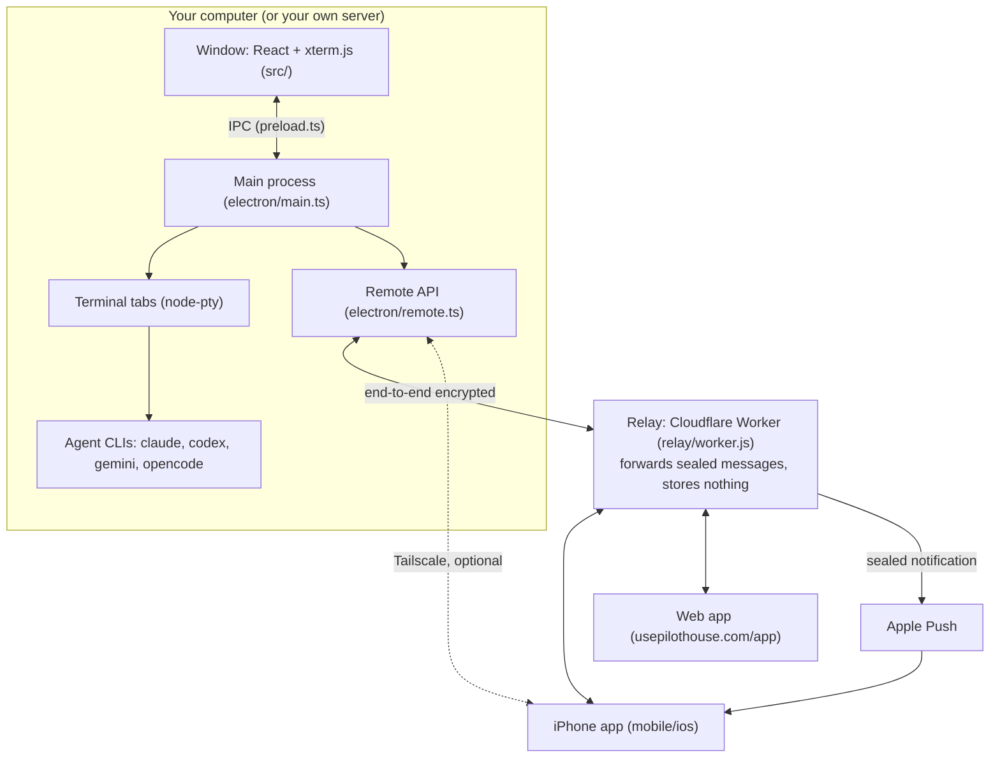

# Architecture

How Pilothouse fits together, for anyone who wants to read or change the code. Two rules shape everything:

- **Your agents, your account.** Pilothouse never calls an AI provider itself. It runs the agent CLIs you already use
  (Claude Code, Codex, Gemini CLI, opencode) in real terminals, and every "smart" feature (debate, the Inbox check)
  is a one-shot run of one of those CLIs, on your tokens, when you press the button.
- **Nothing runs on our side.** No accounts, no database, no inference server. The only hosted piece is a stateless
  relay on the Cloudflare Workers free plan that passes end-to-end encrypted messages along.

## Desktop app

An Electron app. The **renderer** (`src/`) is the window; the **main process** (`electron/`) owns everything that
touches the system. They talk only through the typed bridge in `electron/preload.ts` (`window.electronAPI`, typed in
`src/global.d.ts`).

| Where | What it does |
|---|---|
| `src/App.tsx` | Projects, tabs, layout, settings state |
| `src/components/TabWorkspace.tsx` | One project: terminal, agent and model picker, files, instructions, history, drafts |
| `src/components/EmbeddedTerminal.tsx` | xterm.js (WebGL) bound to a PTY in the main process |
| `src/components/InboxPanel.tsx` | Every tab that needs you: the agent's answer, its steps and errors, "check what was done" |
| `src/components/DebateView.tsx` | Agent debate panel |
| `src/i18n/` | Interface in 10 languages: English strings are the keys, the DOM is translated in place |
| `electron/terminal.ts` | Spawning agent CLIs in PTYs with the flags and model you picked |
| `electron/activity.ts` | Running / waiting / done, guessed from terminal output alone (no agent hooks needed) |
| `electron/screen.ts` | A headless copy of each terminal, so phones see the screen exactly as the desktop does |
| `electron/scanner.ts` | Reads Claude Code and Codex logs on disk: history, last answer, steps (incremental, big logs stay cheap) |
| `electron/agentOptions.ts` | Models and effort levels each agent offers on this computer, read from the agent itself |
| `electron/usage.ts` | Plan usage (5-hour / weekly limits) from files the CLIs keep; never calls a provider |
| `electron/debate.ts` | Agents take turns on one question, read-only, into `.pilothouse/debate.md` |
| `electron/handoff.ts` | When one agent stops, the next reads `.pilothouse/handoff.md` and carries on |
| `electron/voice.ts` | Speech to text on the computer (whisper.cpp); audio never leaves it |
| `electron/store.ts` | Settings and projects in `~/.pilothouse` |
| `electron/control.ts` | Local-only control API (127.0.0.1, token) for other tools on the same computer |

## Remote control (phone and browser)

`electron/remote.ts` is one JSON API (sessions, approve, send, live screen, diff, usage, to-dos, debate) behind two
ways in:

- **Relay** (default, no setup): `electron/relayLink.ts` keeps the computer in a room on `relay/worker.js`. Each
  request and reply is sealed with the device's own AES-256-GCM key; the relay forwards blobs it cannot read and
  stores nothing.
- **Tailscale** (optional): the same API served on the computer's Tailscale address only.

**Pairing** happens once per device, like linked devices in a chat app. A QR code carries a one-time code (one
device, 10 minutes). Both screens show a 6-digit security code, and you click Allow on the computer. Each device then
gets its own token (only its hash is stored in `~/.pilothouse/remote.json`, written atomically) and stays paired until
it is removed. Risky commands need two taps, an approval is refused if the prompt changed since the phone looked, and
every remote action is appended to `~/.pilothouse/remote-audit.jsonl`.

**Notifications**: `electron/push.ts` encrypts each one with the phone's key and hands it to the relay, which passes
it to Apple Push. The iPhone's notification extension decrypts it.

## iPhone app (`mobile/ios`)

SwiftUI, generated with XcodeGen (`project.yml`).

- `App/`: the screens (`Views.swift`), the QR pairing, Face ID for risky approvals, and speech input.
- `Shared/`: the API client (`Client.swift`), Keychain storage and the demo data App Review sees. It is shared with
  the widget and the notification extension.
- `Notifications/`: decrypts pushes and adds Approve / Deny.
- `Widget/`: the home-screen widget and the Live Activity.

App Store screenshots come from a Debug-only `-shots` walk, run by `docs/appstore/shoot.sh` in every language.

The web app is the same API in plain HTML and JS (`electron/remotePage.ts`), served at usepilothouse.com/app.

## Pilothouse server (`server/`)

Pilothouse without a window, for a Linux box, VPS or Mac mini that you run yourself. It reuses the remote API and relay
code from `electron/` with its own terminals (`pilothouse-server.ts`). Phones reach it
through the relay exactly as they reach a desktop.

## Tests

| Command | What it covers |
|---|---|
| `bun tests/selfcheck.ts` | Activity detection, log parsing, remote API security (pairing, auth, risky approvals, audit), debate, i18n key parity |
| `bun tests/ui-smoke.ts` | The built app in a throwaway home, clicked through over the DevTools protocol |

CI (`.github/workflows/check.yml`) runs both on every PR. Releases are built for macOS, Windows and Linux by
GitHub Actions and attached to GitHub Releases.
