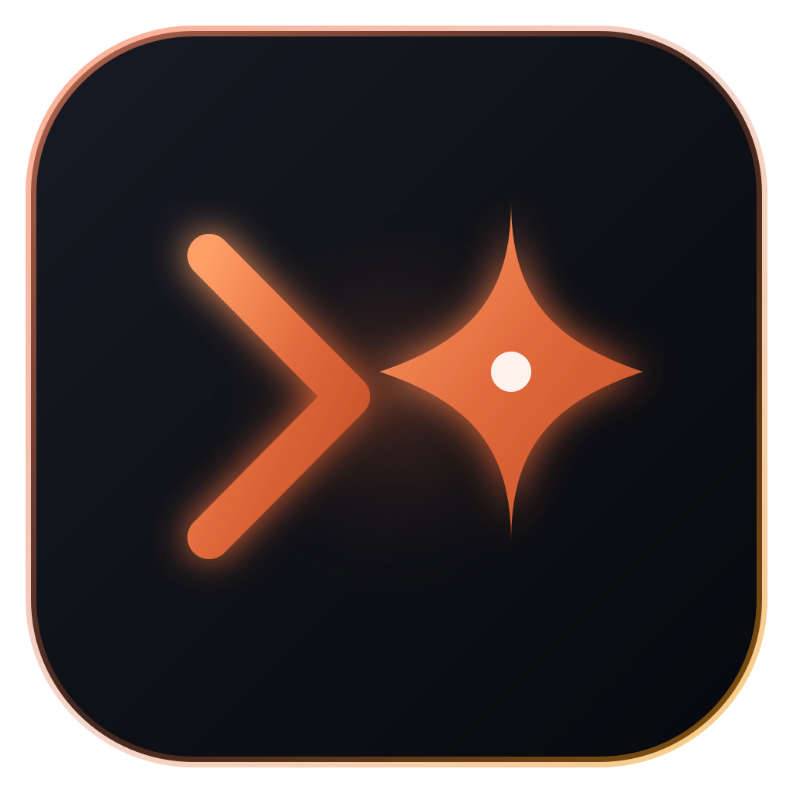
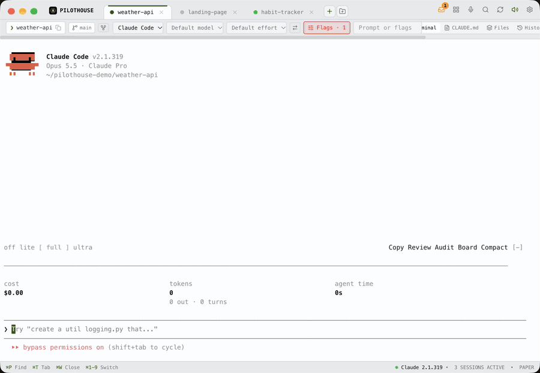

<div align="center">

  

  # Pilothouse
  ### Desktop cockpit with tabbed, embedded terminals for Claude Code, Codex and other terminal AI agents

  [](LICENSE)
  [](https://github.com/aemresrbyk)
  [](#quick-install)
  [](https://react.dev/)
  [](https://www.typescriptlang.org/)

</div>

<p align="center">
  
</p>

> Built with the [Electron framework](https://www.electronjs.org/); not affiliated with the OpenJS Foundation or the Electron project.

**Website:** [usepilothouse.com](https://usepilothouse.com)

Pilothouse keeps all your AI coding projects in one window, and in your pocket: every project gets its own real terminal tab (`node-pty` + `xterm.js`) that starts your agent (`claude`, `codex`, `gemini` or `opencode`) with the flags you choose. You can switch between projects with `⌘1-9`, edit `CLAUDE.md`, browse files and send prompts without leaving the app, and answer your agents from your phone. Free and open source (MIT), no account, no data collected.

---

## Quick install

### macOS

With [Homebrew](https://brew.sh):

```bash
brew install --cask aemresrbyk/tap/pilothouse
```

Or with the install script:

```bash
curl -fsSL https://raw.githubusercontent.com/aemresrbyk/pilothouse/main/install.sh | bash
```

The installer:
- picks the right build for Apple Silicon (`arm64`) or Intel (`x64`),
- installs `Pilothouse.app` into `/Applications`,
- installs a build that is signed with a Developer ID and notarized by Apple, so it opens without Gatekeeper warnings,
- puts a `Pilothouse` alias on your Desktop.

If you run `./install.sh` inside a clone, it builds from source instead of downloading.

### Windows

Download `Pilothouse-Setup-x64.exe` (installer) or `Pilothouse-Portable-x64.exe` (no install) from [Releases](https://github.com/aemresrbyk/pilothouse/releases/latest). The build isn't code-signed yet, so SmartScreen asks once: **More info → Run anyway**.

### Linux (x64)

```bash
curl -fsSL https://raw.githubusercontent.com/aemresrbyk/pilothouse/main/install.sh | bash
```

This puts the AppImage in `~/.local/bin` and adds Pilothouse to your app menu (Ubuntu 22.04+ needs `sudo apt install libfuse2` for AppImages). A `.deb` is on the [Releases](https://github.com/aemresrbyk/pilothouse/releases/latest) page too.

---

## Features

- **Setup on first run.** Pilothouse looks for each agent CLI (Claude Code, Codex, Gemini CLI, opencode) on your shell's PATH and the usual install folders; choose the ones it can't find, or skip them. Then it lists the folders Claude Code and Codex have worked in, with how many sessions each agent has there, and you pick the projects and the agent for each. Run it again from Settings.
- **Tabbed embedded terminals.** Each tab runs a login shell in the project folder and starts Claude automatically. You can open several tabs for the same project (e.g. one for Claude, one for `npm run dev`). Open tabs come back when you restart the app.
- **Any terminal agent.** Pick Claude Code, Codex, Gemini CLI, Antigravity (`agy`) or opencode per project. Each agent keeps its own flags, and the instructions tab edits its file (`CLAUDE.md`, `AGENTS.md`, `GEMINI.md`). History works for Claude Code and Codex.
- **Knows when you're needed.** A tab's dot pulses while the agent works, turns amber when it asks for approval and green when it finished while you were in another tab. You also get a desktop notification and, on macOS, a Dock badge.
- **Inbox (`⌘I` / `Ctrl+Shift+I`).** Everything your agents ask you, in one column: each approval prompt shows the agent's own options as buttons (or press 1–9). Commands that failed are listed apart from questions, with their exit code, and finished tabs get a reply box. Nothing is approved for you. Come back after 5+ minutes away and the Inbox opens on what happened meanwhile.
- **Hand-off between agents.** Ran out of your Claude plan's usage? Pilothouse notices the limit message, and the Inbox offers **Continue with Codex / Gemini / opencode** (or use the ⇄ button next to the agent picker any time). The next agent starts with `.pilothouse/handoff.md`: the last conversation, the uncommitted changes, recent commits and the project's memory and instruction files (`CLAUDE.md`, Claude's auto memory, `AGENTS.md`, `GEMINI.md`). So opencode can see what Claude or Codex did. The folder is added to the repo's local git exclude list, never committed.
- **Resources.** The Inbox's second page shows the CPU and memory of every tab (agent, dev server and their child processes), with a button to stop one.
- **Grid view.** Show all open tabs side by side instead of one at a time.
- **Drag tabs to reorder them.** The order also sets `⌘1`–`⌘9` and the grid; the terminals keep running.
- **Agent debate.** Drafts → **Debate**: pick two or more agents (Claude Code, Codex, Gemini CLI, opencode) and a question. They answer in turns, read-only, each on your own account, and can look at the project but not change it. It stops early when all agree, then one agent writes the decision, open points and a task list to `.pilothouse/debate.md`; **Use decision as draft** puts it in Drafts, ready to send, queue or run in a worktree.
- **Worktree tabs.** The fork button next to the git badge opens a new tab in its own `git worktree` and branch (`pilothouse/<time>`), so two agents on the same repo don't overwrite each other's files.
- **Voice prompts.** Press `⌘⇧Space` (`Ctrl+Shift+Space` on Windows/Linux) anywhere (or the mic button), speak, and your words are typed into the active agent tab. Speech is recognised on your computer with Whisper large-v3-turbo (one-time 574 MB download) and never leaves it. Works with English in any accent, Turkish and ~100 other languages. Optionally say **"Hey Pilothouse"** instead of pressing the hotkey: a small on-device wake-word model (openWakeWord, trained for this phrase) listens while the app sits in the menu bar / system tray.
- **Talk with your agent.** Conversation mode turns voice prompts into a back-and-forth: Pilothouse reads the agent's answer aloud (code stays on screen), asks you to repeat words it wasn't sure it heard, reads approval questions out so you can answer "yes" or "no", and keeps listening. Talk over it to interrupt; say "stop" while the agent works to cancel. Replies in the language you speak (English, Turkish …) with your system's own voices (macOS voices, Windows SAPI voices, or `espeak-ng` on Linux).
- **Model and effort from your own account.** Next to the agent picker, choose the model and effort level each project runs with. The lists come from the agent on your computer: Codex's models and their levels from your ChatGPT/API account, `opencode models` and `agy models` for opencode and Antigravity, Claude Code's effort levels from its own help, and Gemini's aliases (auto, pro, flash, flash-lite). "Default" leaves the agent's own setting. Press **Run** to restart with a new choice.
- **Per-project flags.** The toolbar has on/off toggles for the flags you use (`--continue`, `--verbose`, `--model opus`…). You choose the list, and which ones new projects start with, in Settings. Add any extra flags/prompt in the input bar. **Run** restarts the session with the current command.
- **Quick actions.** The ⋯ menu sends `/doctor`, `/compact`, `/init`, `/cost`, plus "Review Git Diff", "Find Bugs" and "Write Tests" prompts to the running agent, and holds stop, clear, open-in-editor and show-in-folder.
- **Conversation history & search.** Claude Code and Codex conversations of a project in one list, with dates and times; search across all of them with `⌘F` (`Ctrl+Shift+F`). **Resume** reopens one in the agent that wrote it; **Continue with…** hands that exact conversation to another agent (Codex ran out? continue in Claude from the same point).
- **CLAUDE.md editor.** View and edit the project's `CLAUDE.md` in the app, or start from a template if the project doesn't have one.
- **File browser.** Browse project folders and preview files (large files are truncated, open them in your editor for the full content).
- **Prompt drafter.** A per-project scratchpad for multi-line prompts, sent to the terminal with one click.
- **Git badge.** Shows the current branch and the number of modified files.
- **Project discovery.** On first run, imports the projects Claude Code already knows about (`~/.claude.json`). Use the sync button to pick up new ones later. You can add folders with the picker, by typing a path, or by drag & drop.
- **4 themes.** Pilothouse (default: near-black with one signal-lime accent, the logo's colours), OLED Black, Nord Frost and Paper.

> All flags start **off**, including `--dangerously-skip-permissions` (shown in red when on: Claude then runs tools without asking first).
- **Auto-approve rules.** Settings → Auto-approve: one phrase per line (`npm test`, `git status` …). When an agent asks for approval and the request contains one, Pilothouse answers with its first option. Risky commands (`rm -rf`, force-push, `git reset --hard`, deploy, `sudo`, `curl | sh`, `.env` …) are never auto-approved, whatever the rules say. Works for every agent; each one is logged.

---

## From your phone or any browser

<p align="center"><em>The iOS app, or <a href="https://usepilothouse.com/app/">usepilothouse.com/app</a> in any browser. One QR code, no account, no VPN to set up, end-to-end encrypted.</em></p>

- **Every agent, every computer, one list.** What needs you is on top, with the agent each tab runs and its last message. The iPhone app and the web app can each follow several computers and servers.
- **The live terminal**, exactly as on the desktop, with a key bar (Esc, Tab, arrows, Enter, Ctrl+C) and multi-line messages.
- **Approve safely.** The agent's own options as buttons. Risky commands take two taps (and Face ID on the iPhone). If the prompt changed since you looked, your tap is refused instead of approving something else. "What changed" sits right under the prompt.
- **Notifications** when an agent needs you or finishes: lock-screen ones with Approve / Deny on the iPhone, browser notifications in the web app, and a **Live Activity** with the counts.
- **Usage.** How much of Claude Code's 5-hour and weekly limits (and Codex's) you have used, with reset times, read from files the CLIs keep on your computer.
- **Changes and to-dos**, **open any project's agent**, stop a running one, **talk instead of typing**, **widgets**.
- **View-only links** let someone watch without being able to act. **Pilothouse server** runs agents on a Linux box, VPS or Mac mini without a window ([`server`](server)).
- **Audit log.** Every remote action goes to `~/.pilothouse/remote-audit.jsonl` on your computer.

**Set up:** Pilothouse → Settings → **Remote control** → scan the QR code with your phone's camera or the iPhone app. The phone shows a 6-digit security code; your computer shows the same code with the device's approximate location (city, from the relay). Click **Allow** if they match, and the phone is ready. Each QR pairs one device and expires after 10 minutes; remove a device any time in Settings.

**Security** ([full write-up](https://usepilothouse.com/security.html))**:** two ways in, the same API. Through the [relay](relay) (`relay.usepilothouse.com`), every request and reply is sealed with AES-256-GCM using a key that only your computer and that device hold, bound to the device id, with a timestamp and nonce against replays; the relay only passes sealed messages and stores nothing. Or over Tailscale: the computer listens only on its Tailscale address, never on your Wi-Fi network, and checks the `Host` header against DNS rebinding. Either way the computer stores only a hash of each device's token and refuses actions from view-only devices.

The iOS app lives in [`mobile/ios`](mobile/ios) (SwiftUI + WidgetKit; generate the project with `xcodegen`).

---

## Privacy

Pilothouse collects nothing. No accounts, no analytics, no telemetry, no crash reporting. Your code, prompts and terminal output stay on your computer and the devices you pair.

What it talks to on the network, and why:

| Where | When |
|---|---|
| GitHub Releases | update check |
| Hugging Face | one-time voice model download, only if you turn voice on |
| Your paired devices, through the Pilothouse relay (Cloudflare) or over Tailscale | only if you turn Remote control on; end-to-end encrypted, the relay stores nothing |
| Pilothouse relay → Apple Push Notification service | iPhone notifications: an encrypted blob only your phone can open. Live Activity: two numbers (agents needing you, agents working) |
| Your browser's push service | only if you turn on notifications in the web app; encrypted for that browser |

Your agents (Claude Code, Codex …) talk to their own providers as they always do; Pilothouse doesn't sit in between.

---

## Keyboard shortcuts

| macOS | Windows / Linux | Action |
|---|---|---|
| `⌘T` | `Ctrl+Shift+T` | Open the project picker in a new tab |
| `⌘P` / `⌘K` | `Ctrl+Shift+P` / `Ctrl+Shift+K` | Command palette: search, open, or remove projects |
| `⌘I` | `Ctrl+Shift+I` | Inbox: answer agents, see failures and resource use |
| `⌘W` | `Ctrl+Shift+W` | Close the active tab |
| `⌘1` – `⌘9` | `Ctrl+1` – `Ctrl+9` | Switch tabs |
| `⌘C` / `⌘V` | `Ctrl+C` (with a selection) / `Ctrl+V` | Copy selection / paste (bracketed paste, so multi-line pastes don't submit early) |
| `Enter` in the input bar | same | Restart Claude with the current flags + input |

On Windows and Linux the app shortcuts add `Shift`, because plain `Ctrl+T/W/K/P/I/F` are keys your shell uses inside the terminal.

---

## Build from source

Requirements: Node.js 18+ (or [Bun](https://bun.sh)) and at least one supported agent CLI: Claude Code (`npm install -g @anthropic-ai/claude-code`), Codex, Gemini CLI or opencode.

```bash
git clone https://github.com/aemresrbyk/pilothouse.git
cd pilothouse
npm install          # or: bun install
npm run dev          # development mode with live reload
npm run build        # type-check + production bundle
npm run dist:mac     # .dmg / .zip into release/ (on a Mac)
npm run dist:win     # .exe installer + portable (on Windows)
npm run dist:linux   # .AppImage + .deb (on Linux)
npm run build:whisper  # optional: local speech recognition (needs cmake + a C++ compiler)
```

Settings and the project list are stored in `~/.pilothouse/config.json`. Configs from older versions (`~/.electron-app`, `~/.claude-launcher`) are migrated automatically.

---

## Releases

`.github/workflows/build-and-release.yml` builds packages when you push a `v*` tag (or run it manually from the Actions tab) and attaches them to a GitHub Release: macOS `arm64` + `x64` (`Pilothouse-<arch>-mac.zip` / `.dmg`), Windows x64 (`Pilothouse-Setup-x64.exe`, `Pilothouse-Portable-x64.exe`) and Linux x64 (`.AppImage`, `.deb`). Each platform's auto-update feed (`latest-mac.yml`, `latest.yml`, `latest-linux.yml`) is attached too.

### Code signing & notarization

Builds are unsigned unless these repository secrets exist. Once they do, CI signs with the hardened runtime (`build/entitlements.mac.plist`) and notarizes automatically:

| Secret | Value |
|---|---|
| `MAC_CERT_P12_BASE64` | `base64 -i cert.p12` of a **Developer ID Application** certificate (an *Apple Development* cert is not enough) |
| `MAC_CERT_PASSWORD` | the `.p12` export password |
| `APPLE_ID` | Apple ID email |
| `APPLE_APP_SPECIFIC_PASSWORD` | app-specific password from appleid.apple.com |
| `APPLE_TEAM_ID` | 10-character team ID |

Local `npm run pack` / `dist:mac` builds stay unsigned on purpose.

---

## License

MIT, made by **[Ali Emre Sarıbıyık (aemresrbyk)](https://github.com/aemresrbyk)**.
