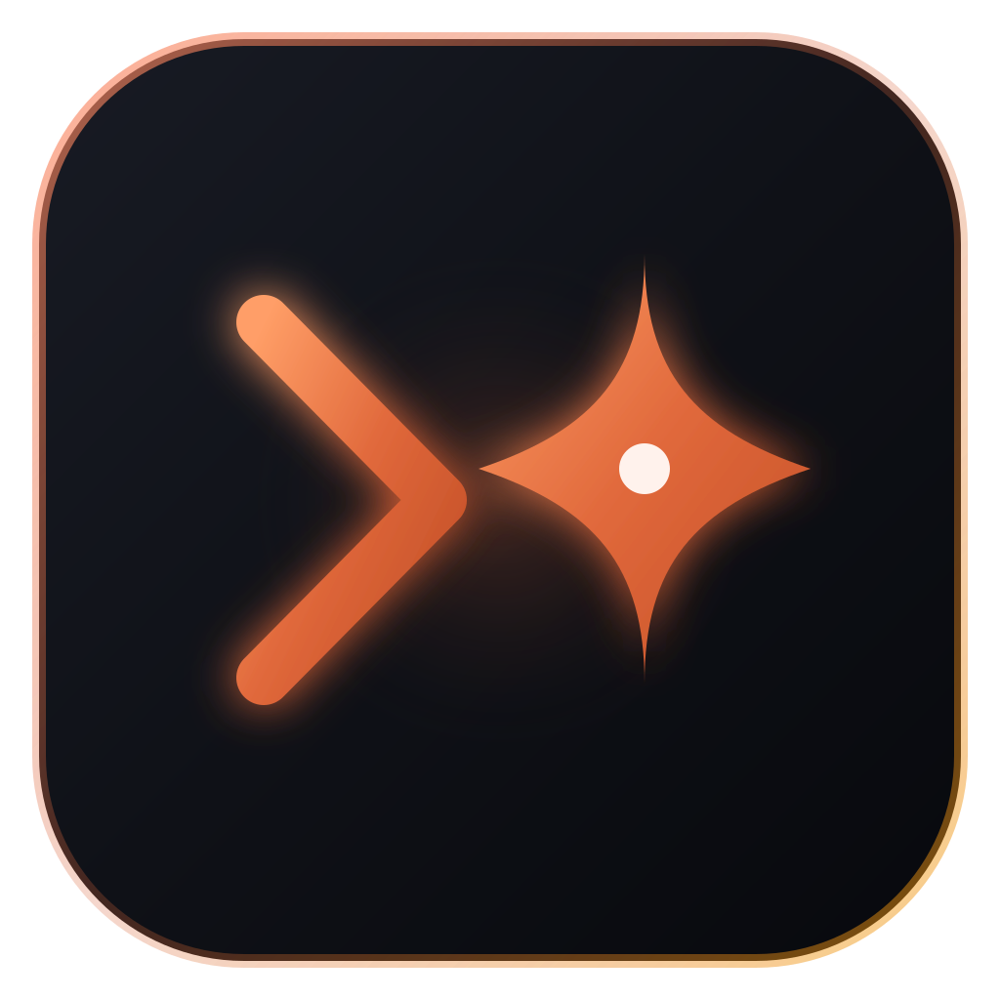

<div align="center">

  

  # Pilothouse
  ### Desktop cockpit with tabbed, embedded terminals for Claude Code, Codex and other terminal AI agents

  [](LICENSE)
  [](https://github.com/aemresrbyk)
  [-black?logo=apple&logoColor=white)](#quick-install-macos)
  [](https://react.dev/)
  [](https://www.typescriptlang.org/)

</div>

> Built with the [Electron framework](https://www.electronjs.org/); not affiliated with the OpenJS Foundation or the Electron project.

**Website:** [kitefoldgames.com/pilothouse-site](https://kitefoldgames.com/pilothouse-site/)

Pilothouse keeps all your AI coding projects in one window: every project gets its own real terminal tab (`node-pty` + `xterm.js`) that starts your agent (`claude`, `codex`, `gemini` or `opencode`) with the flags you choose. You can switch between projects with `⌘1-9`, edit `CLAUDE.md`, browse files and send prompts without leaving the app.

---

## Quick install (macOS)

With [Homebrew](https://brew.sh):

```bash
brew install --cask aemresrbyk/tap/pilothouse
```

Or with the install script:

```bash
curl -fsSL https://raw.githubusercontent.com/aemresrbyk/pilothouse/main/install.sh | bash
```

The installer:
- picks the right build for Apple Silicon (`arm64`) or Intel (`x64`),
- installs `Pilothouse.app` into `/Applications`,
- installs a build that is signed with a Developer ID and notarized by Apple, so it opens without Gatekeeper warnings,
- puts a `Pilothouse` alias on your Desktop.

If you run `./install.sh` inside a clone, it builds from source instead of downloading.

---

## Features

- **Tabbed embedded terminals.** Each tab runs a login shell in the project folder and starts Claude automatically. You can open several tabs for the same project (e.g. one for Claude, one for `npm run dev`). Open tabs come back when you restart the app.
- **Any terminal agent.** Pick Claude Code, Codex, Gemini CLI or opencode per project. Each agent keeps its own flags, and the instructions tab edits its file (`CLAUDE.md`, `AGENTS.md`, `GEMINI.md`). History works for Claude Code and Codex.
- **Knows when you're needed.** A tab's dot pulses while the agent works, turns amber when it asks for approval and green when it finished while you were in another tab. You also get a macOS notification and a Dock badge.
- **Inbox (`⌘I`).** Everything your agents ask you, in one column: each approval prompt shows the agent's own options as buttons (or press 1–9). Commands that failed are listed apart from questions, with their exit code, and finished tabs get a reply box. Nothing is approved for you. Come back after 5+ minutes away and the Inbox opens on what happened meanwhile.
- **Resources.** The Inbox's second page shows the CPU and memory of every tab (agent, dev server and their child processes), with a button to stop one.
- **Grid view.** Show all open tabs side by side instead of one at a time.
- **Worktree tabs.** The fork button next to the git badge opens a new tab in its own `git worktree` and branch (`pilothouse/<time>`), so two agents on the same repo don't overwrite each other's files.
- **Voice prompts.** Press `⌘⇧Space` anywhere (or the mic button), speak, and your words are typed into the active agent tab. Speech is recognised on your Mac with Whisper large-v3-turbo (one-time 574 MB download) and never leaves it. Works with English in any accent, Turkish and ~100 other languages. Optionally say **"Hey Pilothouse"** instead of pressing the hotkey: a small on-device wake-word model (openWakeWord, trained for this phrase) listens while the app sits in the menu bar.
- **Talk with your agent.** Conversation mode turns voice prompts into a back-and-forth: Pilothouse reads the agent's answer aloud (code stays on screen), asks you to repeat words it wasn't sure it heard, reads approval questions out so you can answer "yes" or "no", and keeps listening. Talk over it to interrupt; say "stop" while the agent works to cancel. Replies in the language you speak (English, Turkish …) with macOS's own voices.
- **Per-project flags.** The toolbar has on/off toggles for the flags you use (`--continue`, `--verbose`, `--model opus`…). You choose the list, and which ones new projects start with, in Settings. Add any extra flags/prompt in the input bar. **Run** restarts the session with the current command.
- **Quick actions.** One-click `/doctor`, `/compact`, `/init`, `/cost`, plus "Review Git Diff", "Find Bugs" and "Write Tests" prompts sent to the running Claude session.
- **Conversation history & search.** Read every past conversation of a project with dates and times, search across all of them with `⌘F`, and reopen one with one click. Works for Claude Code and Codex.
- **CLAUDE.md editor.** View and edit the project's `CLAUDE.md` in the app, or start from a template if the project doesn't have one.
- **File browser.** Browse project folders and preview files (large files are truncated, open them in your editor for the full content).
- **Prompt drafter.** A per-project scratchpad for multi-line prompts, sent to the terminal with one click.
- **Git badge.** Shows the current branch and the number of modified files.
- **Project discovery.** On first run, imports the projects Claude Code already knows about (`~/.claude.json`). Use the sync button to pick up new ones later. You can add folders with the picker, by typing a path, or by drag & drop.
- **5 themes.** Anthropic Warm, OLED Black, Cyber Slate, Nord Frost, Paper Minimal.

> All flags start **off**, including `--dangerously-skip-permissions` (shown in red when on: Claude then runs tools without asking first).

---

## Keyboard shortcuts

| Shortcut | Action |
|---|---|
| `⌘T` | Open the project picker in a new tab |
| `⌘P` / `⌘K` | Command palette: search, open, or remove projects |
| `⌘I` | Inbox: answer agents, see failures and resource use |
| `⌘W` | Close the active tab |
| `⌘1` – `⌘9` | Switch tabs |
| `⌘C` / `⌘V` | Copy selection / paste (bracketed paste, so multi-line pastes don't submit early) |
| `Enter` in the input bar | Restart Claude with the current flags + input |

Windows and Linux builds are planned. The code already has Windows/Linux paths and builds from source with `npm run dist:win` / `dist:linux`, but they are not tested or released yet. There, use `Ctrl` instead of `⌘`.

---

## Build from source

Requirements: Node.js 18+ (or [Bun](https://bun.sh)) and at least one supported agent CLI: Claude Code (`npm install -g @anthropic-ai/claude-code`), Codex, Gemini CLI or opencode.

```bash
git clone https://github.com/aemresrbyk/pilothouse.git
cd pilothouse
npm install          # or: bun install
npm run dev          # development mode with live reload
npm run build        # type-check + production bundle
npm run dist:mac     # .dmg / .zip into release/
```

Settings and the project list are stored in `~/.pilothouse/config.json`. Configs from older versions (`~/.electron-app`, `~/.claude-launcher`) are migrated automatically.

---

## Releases

`.github/workflows/build-and-release.yml` builds macOS `arm64` and `x64` packages when you push a `v*` tag (or run it manually from the Actions tab), and attaches `Pilothouse-<arch>-mac.zip` / `.dmg` to a GitHub Release.

### Code signing & notarization

Builds are unsigned unless these repository secrets exist. Once they do, CI signs with the hardened runtime (`build/entitlements.mac.plist`) and notarizes automatically:

| Secret | Value |
|---|---|
| `MAC_CERT_P12_BASE64` | `base64 -i cert.p12` of a **Developer ID Application** certificate (an *Apple Development* cert is not enough) |
| `MAC_CERT_PASSWORD` | the `.p12` export password |
| `APPLE_ID` | Apple ID email |
| `APPLE_APP_SPECIFIC_PASSWORD` | app-specific password from appleid.apple.com |
| `APPLE_TEAM_ID` | 10-character team ID |

Local `npm run pack` / `dist:mac` builds stay unsigned on purpose.

---

## License

MIT, made by **[Ali Emre Sarıbıyık (aemresrbyk)](https://github.com/aemresrbyk)**.
